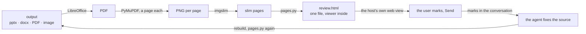

# lossless-kit

What lossless hands out: skills, a plugin for T3 Code, and the code they load.

## skills

`skills/` holds the skills, one folder each with its `SKILL.md`:

| Skill | What it does |
| --- | --- |
| `pad` | draw a concept with the user on a board inside the conversation, until you share one understanding of it |
| `split` | open a child conversation or a subagent from this conversation |
| `attention` | pick up where the last session stopped, or hand this one off |
| `merge-branch` | merge a unit of work into its base: check nothing is left behind, rebase, test, open a PR |
| `visual-it` | create or redesign a self-contained single-file HTML artifact with a visual direction shaped by the brief |
| `visual-review` | go over a finished output (deck, PDF, image, ad, message) with the user by eye, marking on its pages until nothing is unclear |
| `readable` | readable names for files, folders and archives, each carrying a short, clear meaning of what it is |

## pad

`pad/board.js` is the drawing board of the `pad` skill: the user draws inside the agent conversation, presses Send, and
the board prints the drawing as structure (shapes and their nesting, connections from → to, text, highlights by color).

A page loads it with one script tag, at a pinned version:

```html
<script>window.PREFS = { lock: false, shape: "rect", line: "arrow" };</script>
<script src="https://cdn.jsdelivr.net/gh/lossless-hq/lossless-kit@v0.1.1/pad/board.js"></script>
```

`PREFS`: `lock` keeps a tool on after one use; `shape` is `rect`, `ellipse` or `diamond`; `line` is `arrow`, `line` or
`both`.

Test: `bun install`, then `bun run test` (a real mouse on the board, through the Chrome installed on the machine).

## visual-review

The `visual-review` skill goes over a finished output (deck, PDF, image, document) with the user by eye: the pages one
under the other, the user drags on a page to mark a region and types what is unclear. **Send** prints the marks as
structure (page, place on the page, the person's words), and where the host takes a page's `ui/message` they arrive as
the user's next message.



Everything it needs sits in the skill's folder:

```
skills/visual-review/
  SKILL.md           the steps
  agents/openai.yaml
  scripts/pages.py   the whole chain, from the file to review.html
  scripts/viewer.js  the marking layer, inlined into review.html
```

The page is one file with its images and viewer inside, so it opens the same in any host and needs no internet. The
output is never edited through the pages: a fix lands in whatever builds the output, and the next run starts from an
empty folder. A missing tool stops `pages.py` with the tool named; the skill asks before installing it.

## License

Apache License 2.0 ([LICENSE](LICENSE)). Work built on this code keeps the [NOTICE](NOTICE) with it.
